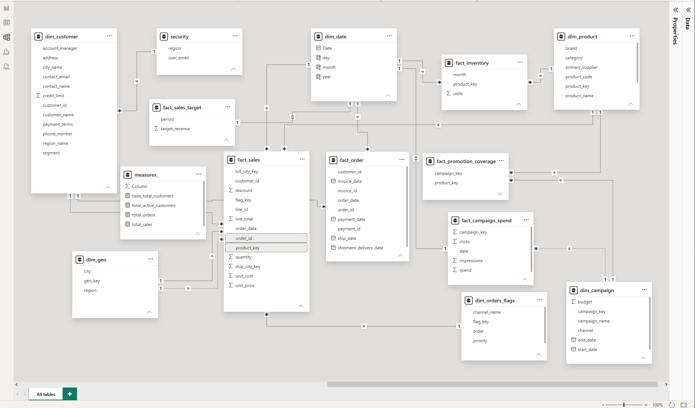

<h1 align="center">Power BI Sales Data Model</h1>

<p align="center">
  An end-to-end data modeling project: 21 raw Excel sheets transformed into a<br>
  star-schema semantic model in Power BI, with DAX measures and row-level security.
</p>

<p align="center">
  
  
  
  
  
</p>

---

## Table of Contents
1. [Project Overview](#project-overview)
2. [Business Problem](#business-problem)
3. [Data Model](#data-model)
4. [Tables and Columns](#tables-and-columns)
5. [Relationships and Design Decisions](#relationships-and-design-decisions)
6. [Data Preparation](#data-preparation)
7. [DAX Measures](#dax-measures)
8. [Row-Level Security](#row-level-security)
9. [Source Dataset](#source-dataset)
10. [Repository Structure](#repository-structure)
11. [How to Run](#how-to-run)
12. [Key Learnings](#key-learnings)
13. [Author](#author)

---

## Project Overview
This project converts a disconnected set of operational Excel sheets (orders, customers, products, invoices, payments, shipments, inventory, marketing campaigns and sales targets) into a single, analysis-ready **Power BI semantic model**.

The emphasis is on **data modeling**: separating facts from dimensions, sharing conformed dimensions across several fact tables, organizing measures in one place and securing data by region.

| Item | Detail |
|------|--------|
| Fact tables | 6 |
| Dimension tables | 6 |
| Supporting tables | `security` (RLS), `measures_` (DAX) |
| Source | 21-sheet Excel workbook |
| Tools | Power BI Desktop, Power Query, DAX, Excel |

## Business Problem
Source data was spread across many sheets with no defined relationships, and orders were split by year (`ORDERS_2025`, `ORDERS_2026`). This made it difficult to:
- Report on sales, orders and active customers from one place
- Compare actual sales with sales targets over time
- Connect marketing spend and promotions to products and sales
- Track inventory alongside sales
- Restrict each user to the regions they are allowed to see

## Data Model


The model is a **constellation (multi-fact star) schema**: several fact tables share common dimensions such as `dim_date`, `dim_product`, `dim_customer` and `dim_geo`.

| Layer | Tables |
|-------|--------|
| **Facts** | `fact_sales`, `fact_order`, `fact_inventory`, `fact_sales_target`, `fact_campaign_spend`, `fact_promotion_coverage` |
| **Dimensions** | `dim_customer`, `dim_product`, `dim_geo`, `dim_date`, `dim_campaign`, `dim_orders_flags` |
| **Supporting** | `security`, `measures_` |

## Tables and Columns

### Fact tables
| Table | Grain / Purpose | Key columns |
|-------|-----------------|-------------|
| `fact_sales` | One row per order line | `order_id`, `line_id`, `customer_id`, `product_key`, `order_date`, `quantity`, `unit_price`, `unit_cost`, `discount`, `line_total`, `bill_city_key`, `ship_city_key`, `flag_key` |
| `fact_order` | Order lifecycle (order → invoice → payment → shipment) | `order_id`, `customer_id`, `order_date`, `invoice_id`, `invoice_date`, `payment_id`, `payment_date`, `ship_date`, `shipment_delivery_date` |
| `fact_inventory` | Inventory units per product per month | `product_key`, `month`, `units` |
| `fact_sales_target` | Target revenue by period | `period`, `target_revenue` |
| `fact_campaign_spend` | Daily marketing performance | `campaign_key`, `date`, `impressions`, `clicks`, `spend` |
| `fact_promotion_coverage` | Bridge between campaigns and promoted products | `campaign_key`, `product_key` |

### Dimension tables
| Table | Purpose | Key columns |
|-------|---------|-------------|
| `dim_customer` | Customer master with contact and account details | `customer_id`, `customer_name`, `segment`, `account_manager`, `payment_terms`, `credit_limit`, `contact_name`, `contact_email`, `phone_number`, `address`, `city_name`, `region_name` |
| `dim_product` | Product catalog | `product_key`, `product_code`, `product_name`, `brand`, `category`, `primary_supplier` |
| `dim_geo` | City and region lookup | `geo_key`, `city`, `region` |
| `dim_date` | Calendar table | `Date`, `day`, `month`, `year` |
| `dim_campaign` | Marketing campaigns | `campaign_key`, `campaign_name`, `channel`, `budget`, `start_date`, `end_date` |
| `dim_orders_flags` | Order attributes | `flag_key`, `channel_name`, `order`, `priority` |

### Supporting tables
| Table | Purpose |
|-------|---------|
| `security` | Maps `user_email` to `region` for row-level security |
| `measures_` | Holds all DAX measures |

## Relationships and Design Decisions
- **Conformed dimensions:** `dim_date` and `dim_product` are shared by multiple fact tables, so sales, orders, inventory, targets and campaigns can be analyzed on the same axes.
- **Role-playing geography:** `fact_sales` carries both `bill_city_key` and `ship_city_key`, both pointing to `dim_geo`. One relationship is active and the other is inactive and can be activated in DAX where needed.
- **Bridge table:** `fact_promotion_coverage` resolves the many-to-many relationship between campaigns and products.
- **Order lifecycle fact:** `fact_order` consolidates order, invoice, payment and shipment dates in one table.
- **Dedicated measures table:** All measures are kept in `measures_` to keep the model tidy and easy to navigate.
- **Security layer:** `security` filters the geography dimension so users see only their own region.

## Data Preparation
Performed in **Power Query**:
- Combined `ORDERS_2025` and `ORDERS_2026` into a single order dataset
- Built dimension tables from customer, address, city, region and product sheets
- Built fact tables from order lines, invoices, payments, shipments, inventory, campaigns and targets
- Generated surrogate keys (`product_key`, `geo_key`, `campaign_key`, `flag_key`)
- Set correct data types and removed unused columns
- *(Add any additional cleaning steps you applied)*

## DAX Measures
All measures live in the `measures_` table.

| Measure | Description |
|---------|-------------|
| `total_sales` | Total sales value |
| `total_orders` | Number of orders |
| `total_active_customers` | Count of active customers |
| `base_total_customers` | Base count of customers |

## Row-Level Security
The `security` table maps each `user_email` to a `region`. A role filters the model so each user sees only the data for the region assigned to them.

To test in Power BI Desktop: **Modeling → View as → select the role**.

## Source Dataset
`dataset/dataset.xlsx` contains 21 raw sheets:

| Area | Sheets |
|------|--------|
| Orders | `ORDERS_2025`, `ORDERS_2026`, `order_line_items`, `dim_order` |
| Customers | `CUST_MASTER`, `customer_contacts`, `user_details`, `Address` |
| Products and Inventory | `products`, `subcategories`, `inventory` |
| Finance | `INVOICES`, `invoice_lines`, `payments`, `exchange_rates` |
| Logistics | `shipments`, `Sheet1` |
| Marketing | `CAMPAIGN_LOG`, `campaign_skus` |
| Geography | `cities`, `regions` |
| Targets and Security | `sales_targets`, `security` |

> The dataset is provided for learning and demonstration purposes.

## Repository Structure
```
powerbi-sales-data-model/
├── datamodel/
│   └── schema.png                       # Model view screenshot
├── dataset/
│   └── dataset.xlsx                     # Source Excel workbook (21 sheets)
├── workbook/
│   └── srinu_project_datamodel.pbix     # Power BI data model and report
└── README.md
```

## How to Run
1. Clone or download the repository
   ```bash
   git clone https://github.com/Srinivas-49/powerbi-sales-data-model.git
   ```
2. Open `workbook/srinu_project_datamodel.pbix` in **Power BI Desktop**
3. If prompted, go to **Transform data → Data source settings** and point the source to `dataset/dataset.xlsx`
4. Click **Refresh**

**Requirements:** Power BI Desktop (latest version recommended)

## Key Learnings
- A well-designed model simplifies DAX and improves report performance
- Sharing dimensions across multiple fact tables enables cross-process analysis
- Bridge tables and role-playing dimensions solve real-world modeling cases
- Keeping measures in a dedicated table makes projects easier to maintain
- Row-level security should be planned as part of the model design

## Author
**Srinivas**
GitHub: [@Srinivas-49](https://github.com/Srinivas-49)


---
<p align="center"><i>If you found this project useful, please consider giving it a star ⭐</i></p>
